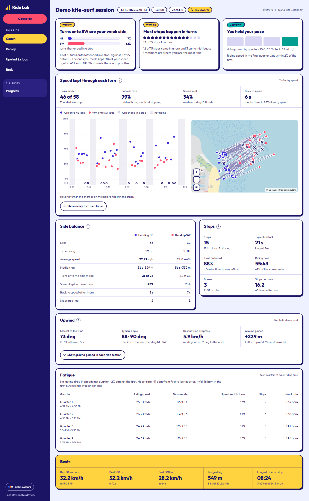
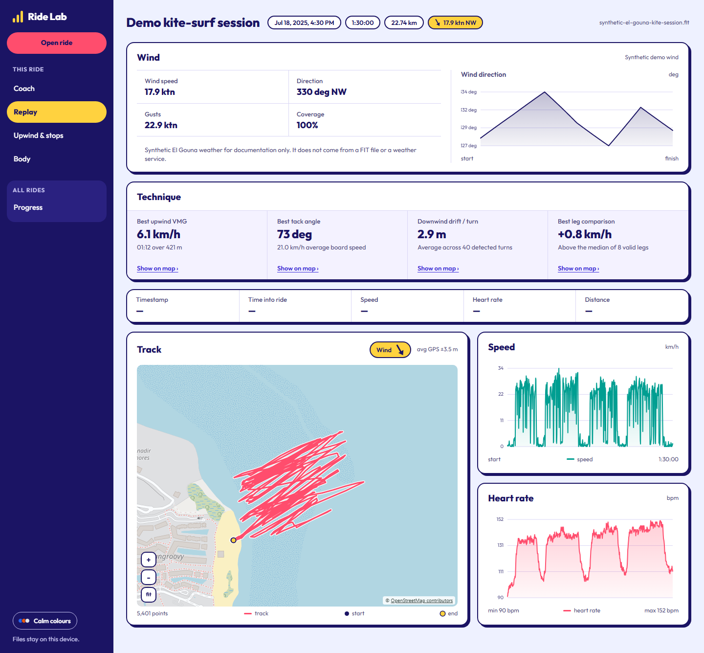
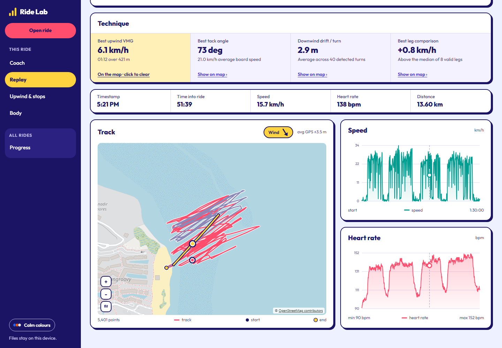
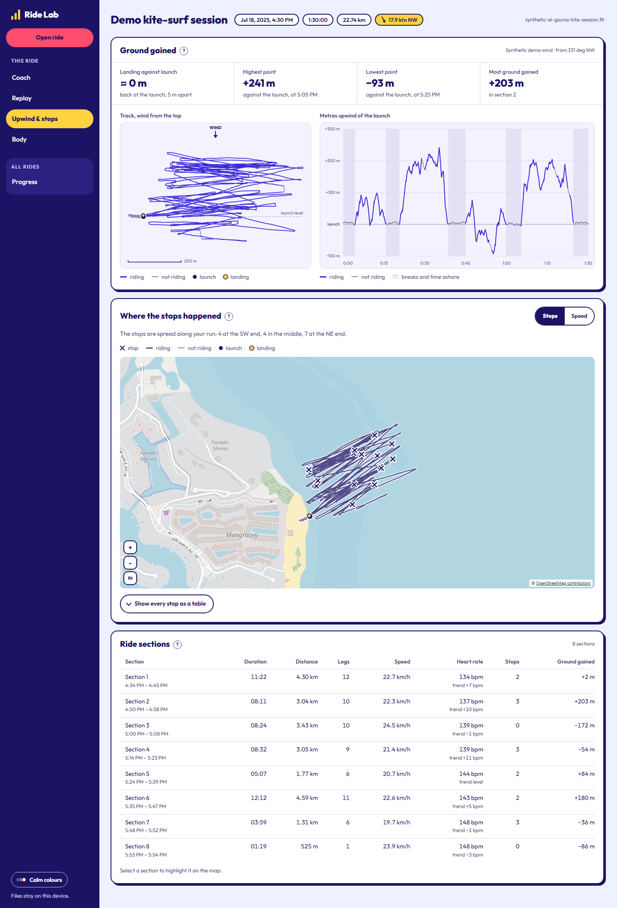
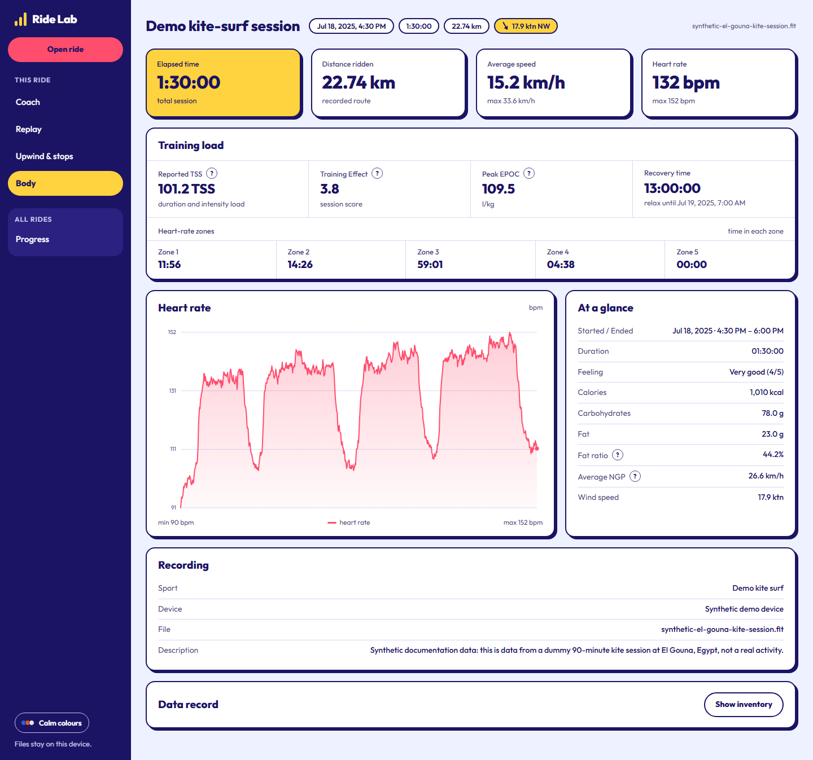
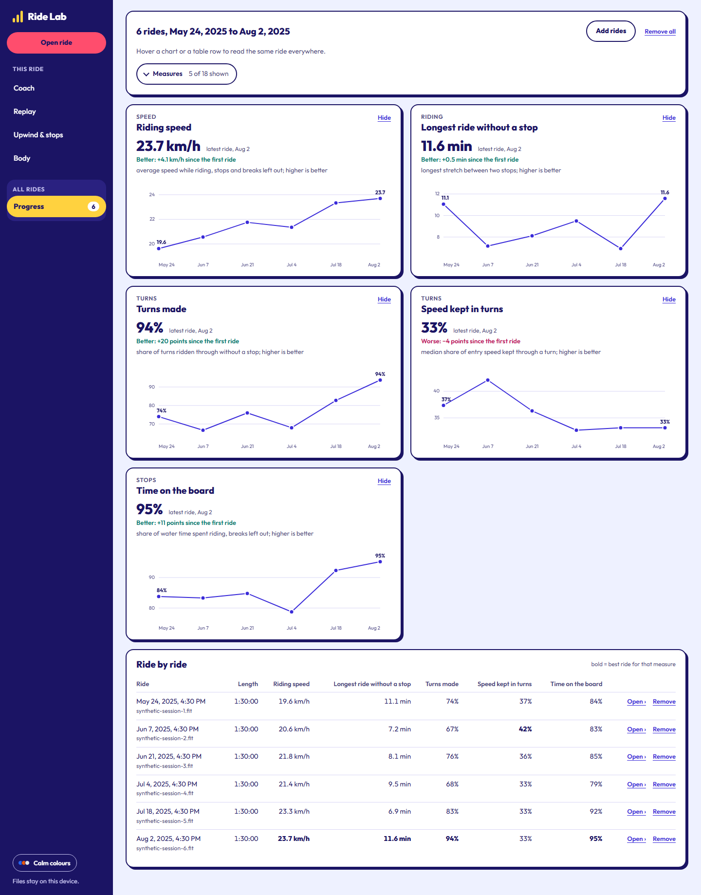

# Kitesurf .fit File Session Analytics

A web dashboard for exploring a sport `.fit` formated file data export. This app is specifically tailored to analyse kite surf sessions. It was designed and tested with Suunto `.fit` generated data, but generally works with any `.fit` compatible files from other manufacturers like Garmin, etc.

The app opens on **Coach**, the page that tells you what to work on. The menu has two groups: four pages about the one ride that is open, and **Progress**, which compares several rides.

### Coach



Turns the legs found in each ride section into things to work on. Everything is worked out in the browser from timestamps, speed, heart rate and GPS; only the upwind figures need a wind direction.

- **Takeaways:** up to three rule-based observations that do not repeat each other, such as a weaker turning side or where most stops happen, with one slot kept for something that went well. Most come with a small picture of the numbers behind them.
- **Speed kept through each turn:** for every turn between two legs, the share of entry speed kept, the time to get back to speed, and whether the turn ended in a stop. Every turn is also marked on a map beside the chart: hover a turn in either one to find it in the other and see the stretch ridden into and out of it. A table of all turns is below.
- **Side balance:** legs, speed, turn success and mid-leg stops for one riding direction against the other.
- **Stops:** number of stops, whether they came in a turn or mid-leg, typical restart time, and the share of water time spent on the board. Getting up for a few seconds and going down again counts as a failed restart of the same stop. Stops longer than two minutes count as breaks.
- **Upwind:** angle to the wind per direction, best upwind progress, and ground gained or lost, also per ride section. These figures are only as accurate as the wind direction, and modelled hourly wind is approximate.
- **Fatigue:** riding speed, turn quality, stops and heart rate across four quarters of equal riding time, with the point where speed dropped for good marked. Needs at least 20 minutes of riding.
- **Bests:** best speed over 10 seconds, 100 m and 500 m, the longest leg, and the longest ride without a stop.

Definitions and caveats sit behind the small **?** next to a heading instead of in a paragraph under it.

### Replay



The whole session over time: wind, speed, heart rate and the track.



Move across a chart or the track and the same moment is marked in all of them. A technique figure that has a place on the track can be shown on the map.

### Upwind & stops



Shows where things happen on the water, from the GPS track.

- **Ground gained:** the track and a chart of metres upwind of the launch, both turned so the wind comes from the top, and how far downwind of the launch you came back in. Needs a wind direction.
- **Stops:** each stop on the map, drawn at the last GPS fix before it, with a note when most of them happen at one end of your run.
- **Speed:** the same map with riding stretches coloured by speed.
- **Ride sections:** a table of the riding sections found in the session, with duration, distance, legs between turns, average speed, heart rate, stops and ground gained upwind. A section is a stretch of sustained riding speed; stops shorter than about 25 seconds are bridged and longer breaks split sections. Select a row to highlight that section on the map.

### Body



The effort side of the ride: session totals, training load, heart-rate zones, the heart-rate chart, calories and the other values the watch saved, and a record of everything the file contains.

### Progress



Compares several rides over time. Choose as many `.fit` files as you like at once (or drop them on the page); each ride is reduced to a few measures and shown as one small chart per measure, with the rides in date order.

- **Shown to start with:** riding speed, longest ride without a stop, turns made, speed kept in turns, and time on the board.
- **More under Measures:** best 10 seconds and 500 m, time and distance ridden, typical leg length, time back to speed after a turn, the gap between your two sides, stops per hour, typical restart, heart rate while riding, and three upwind measures.
- **Reading it:** each chart says whether the measure got better or worse since the first ride. Hover a chart or a table row to read the same ride in every chart, and open any ride from the table to see it in full on the other pages.
- **Upwind measures** look up the wind for every ride, and only once you switch one of them on.

## Privacy

- Your selected .FIT file is decoded, analysed and rendered in the your local browser only.
- The .FIT file and derived activity data are held only in the current page's memory. The app does not write them to local storage, IndexedDB, cookies, or an account. Reloading or closing the tab clears the current activity.
- The only thing kept in the browser is which of the two looks you picked.
- When a GPS track is visible, your browser requests the required OpenStreetMap tiles based on track GPS location.
- Wind data is loaded from OpenMeteo using the GPS coordinates and the session's UTC start/end timestamps.
- On the Progress page only the measures of each ride are kept in memory, and the wind is looked up for those rides only after you switch on an upwind measure.
- The font is part of the app (`public/fonts`, Outfit, SIL Open Font License), so no font service is contacted.

## Run

Install Node.js 18 or newer, then run:

```bash
npm run app
```

Open <http://127.0.0.1:4173>. Use **Open ride** or drag a file onto the start panel. Add `?demo` to the address to look around with a made-up session. To use another port:

```bash
npm run app -- --port 4174
```

The decoder validates FIT header and file CRCs, understands standard FIT definitions, compressed timestamps, FIT scaling, GPS/speed/heart-rate fields, standard weather conditions, and Suunto developer-field descriptions. Maps draw a downsampled GPS track over OpenStreetMap tiles. Unknown messages and fields remain in the parsed activity model so records, route, and sport-specific pages can be added without changing the import flow.