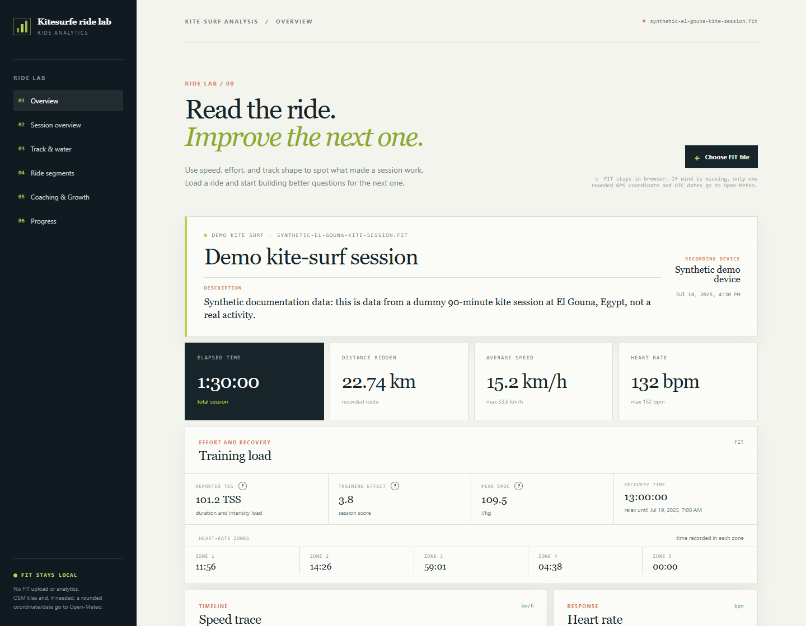
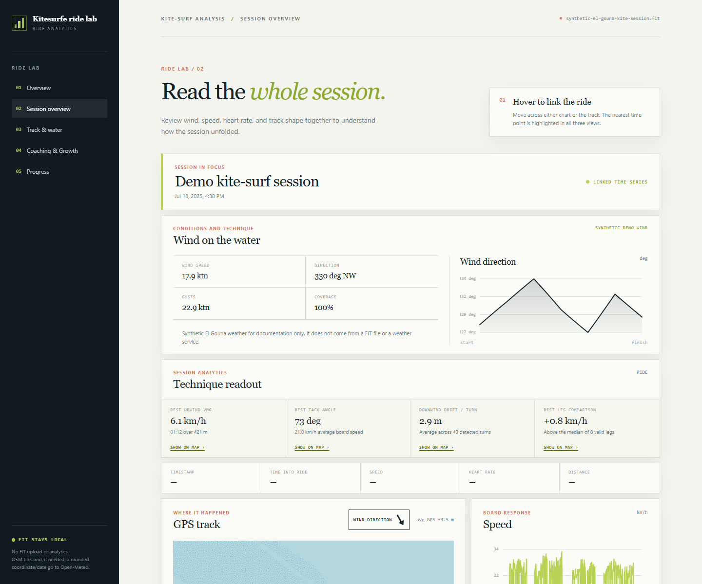
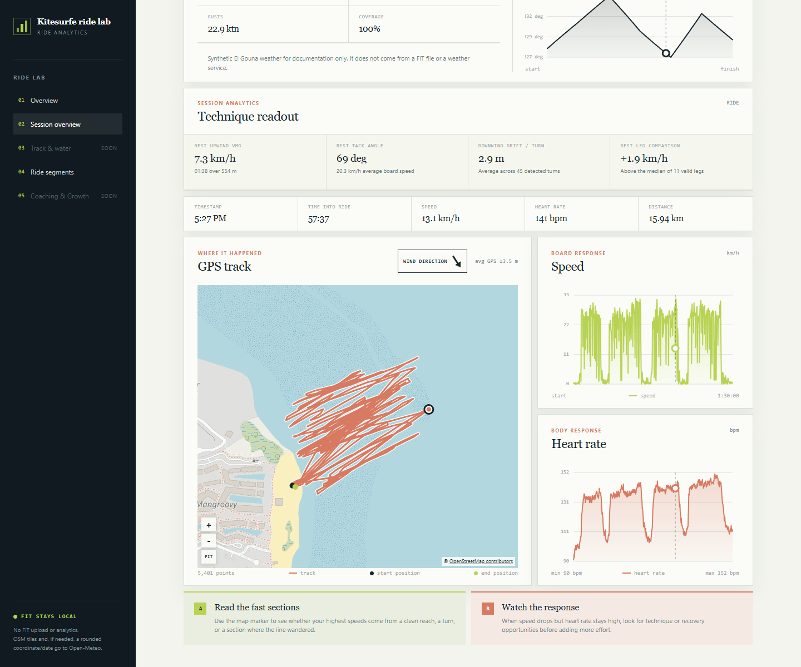
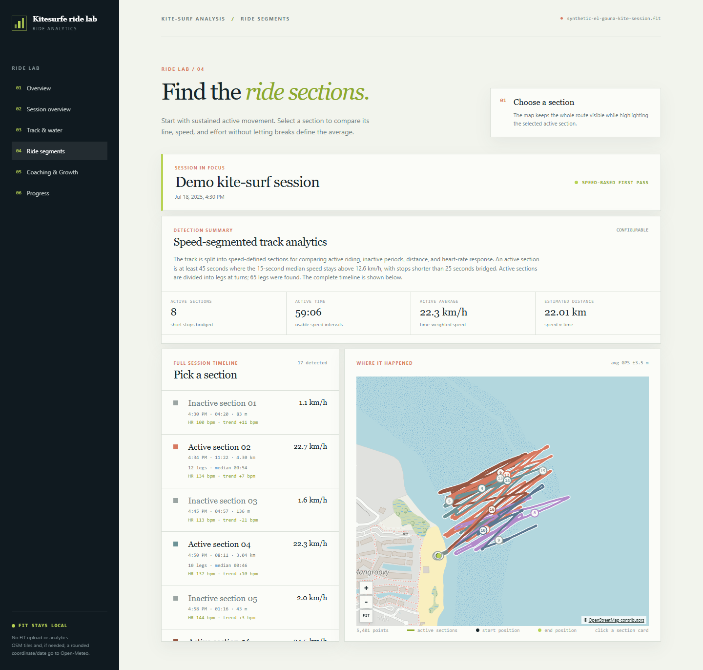
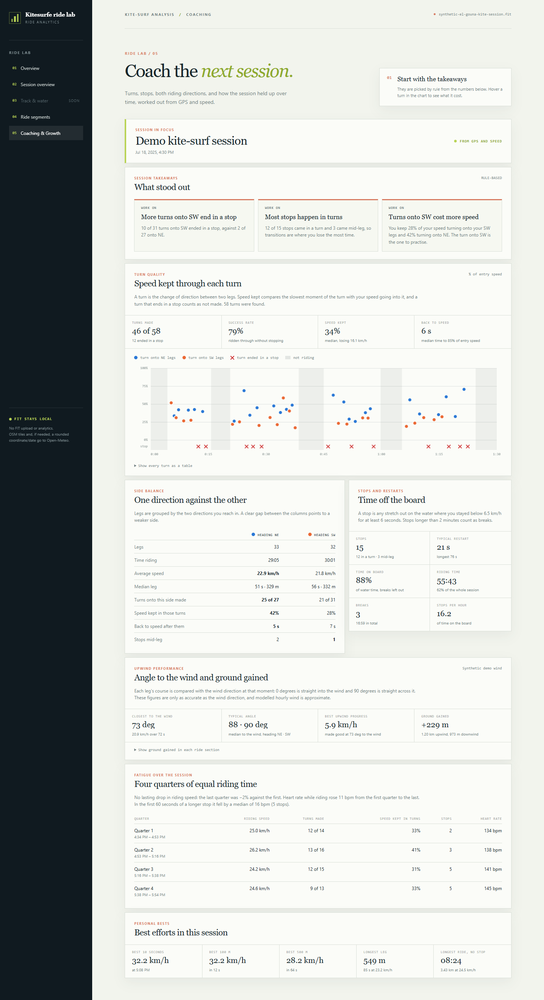

# Kitesurf .fit File Data Session Analytics 

A web dashboard for exploring a sport `.fit` formated file data export. This app is specifically tailored to analyse kite surf sessions. It was designed and tested with Suunto `.fit` generated data, but generally works with any `.fit` compatible files from other manufacturers like Garmin, etc.

### Overview



Shows the sessions training load metrics and health sensor data visualizations like speed and heart rate as well as the track location on static map.

### Session overview



Highligthed session events and wind data annotation.



Analyze sensor data linked to every geographic location on the map at any point in time.

### Ride segments



Automatically detected session segments along the recorded track with statistic for each split.

### Coaching & Growth



Turns the detected legs into things to work on. Everything is worked out in the browser from timestamps, speed, heart rate and GPS; only the upwind figures need a wind direction.

- **Session takeaways:** up to three rule-based observations, such as a weaker turning side or where most stops happen.
- **Turn quality:** for every turn between two legs, the share of entry speed kept, the time to get back to speed, and whether the turn ended in a stop. Hover a turn in the chart for its details, or open the table below it.
- **Side balance:** legs, speed, turn success and mid-leg stops for one riding direction against the other.
- **Stops and restarts:** number of stops, whether they came in a turn or mid-leg, typical restart time, and the share of water time spent on the board. Stops longer than two minutes count as breaks.
- **Upwind performance:** angle to the wind per direction, best upwind progress, and ground gained or lost, also per ride section. These figures are only as accurate as the wind direction, and modelled hourly wind is approximate.
- **Fatigue over the session:** riding speed, turn quality, stops and heart rate across four quarters of equal riding time, with the point where speed dropped for good marked. Needs at least 20 minutes of riding.
- **Personal bests:** best speed over 10 seconds, 100 m and 500 m, the longest leg, and the longest ride without a stop.

## Privacy

- Your selected .FIT file is decoded, analysed and rendered in the your local browser only.
- The .FIT file and derived activity data are held only in the current page's memory. The app does not write them to local storage, IndexedDB, cookies, or an account. Reloading or closing the tab clears the current activity.
- When a GPS track is visible, your browser requests the required OpenStreetMap tiles based on track GPS location.
- Wind data is loaded from OpenMeteo using the GPS coordinates and the session's UTC start/end timestamps.

## Run

Install Node.js 18 or newer, then run:

```bash
npm run app
```

Open <http://127.0.0.1:4173>. Use **Choose FIT file** or drag a file into the panel. To use another port:

```bash
npm run app -- --port 4174
```

The decoder validates FIT header and file CRCs, understands standard FIT definitions, compressed timestamps, FIT scaling, GPS/speed/heart-rate fields, standard weather conditions, and Suunto developer-field descriptions. The overview draws a downsampled GPS track over OpenStreetMap tiles and expands compact message sections with representative field values while leaving time-series values out. Unknown messages and fields remain in the parsed activity model so records, route, and sport-specific pages can be added without changing the import flow.

## Test

```bash
npm test
```

The tests run on made-up tracks and the bundled demo session only; no recorded sessions are used as fixtures.
